# 📊 Data Analytics End-to-End Projects Portfolio

Portfolio praktických analytických projektů zaměřených na **řešení business problémů od zdrojových dat až po interpretaci, reporting a doporučení pro rozhodování**.

Výraznou oblastí portfolia je **výrobní a související finanční controlling**: plnění výroby, náklady a jejich odchylky, provozní efektivita, kvalita, zásoby, produktová ziskovost a nákladové prognózy. Důraz je na propojení provozních výsledků s ekonomickým dopadem a na podklady pro výrobní a finanční vedení.

Repozitář zahrnuje také logistickou výkonnost, zákaznickou retenci a analýzu investičních fondů. Projekty využívají Excel, Power Query, Power Pivot, SQL Server, Power BI, DAX, Python, API a automatizaci podle potřeb konkrétní úlohy.

Hlavní důraz je kladen na:

- pochopení business problému;
- kontrolu kvality a přípravu dat;
- přiměřený návrh transformačního procesu;
- analytickou interpretaci;
- KPI a datové modelování;
- reporting a interaktivní dashboardy;
- porovnání plánu, přepočteného plánu a skutečnosti;
- propojení nákladů, provozního výkonu, zásob a ziskovosti;
- formulaci prognóz, priorit a doporučení;
- dokumentaci rozhodnutí a omezení.

---

# 📂 Struktura repozitáře

```text
da-end-to-end-projects-portfolio/
├── projects/
│   ├── project-01-csv-excel-power-query/
│   │   ├── data/
│   │   ├── output/
│   │   ├── dataset_manifest.csv
│   │   └── README.md
│   │
│   ├── project-02-sql-power-bi-dax/
│   │   ├── data/
│   │   ├── docs/
│   │   ├── output/
│   │   ├── power-bi/
│   │   ├── sql/
│   │   ├── .gitignore
│   │   └── README.md
│   │
│   ├── project-03-api-python-sql-power-bi/
│   │   ├── data/
│   │   ├── docs/
│   │   ├── logs/
│   │   ├── notebooks/
│   │   ├── output/
│   │   ├── power-bi/
│   │   ├── python/
│   │   ├── sql/
│   │   ├── .gitignore
│   │   ├── README.md
│   │   ├── requirements.txt
│   │   └── run_pipeline.bat
│   │
│   ├── project-04-sql-excel-power-bi/
│   │   ├── data/
│   │   ├── excel/
│   │   ├── output/
│   │   ├── power-bi/
│   │   ├── production-controlling-cheatsheet/
│   │   ├── sql/
│   │   ├── .gitignore
│   │   └── README.md
│   │
│   └── project-05-excel-power-pivot-dax/
│       ├── data/
│       │   ├── clean/
│       │   └── raw/
│       ├── excel/
│       │   └── cnc_plant_performance.xlsx
│       ├── output/
│       │   ├── screenshots/
│       │   └── findings_recommendations.md
│       └── readme.md
│
├── workflow/
│   └── analytical-workflow.md
│
└── README.md
```

---

# 🎯 Projekty

## ✅ Project 01 — Logistics Performance & Service Level Analysis

**CSV + Power Query + Excel**

Dokončený end-to-end projekt zaměřený na výkonnost logistického procesu smyšlené distribuční společnosti.

Projekt analyzuje **250 000 unikátních zásilek za období 2025 a 2026**, referenční data a zákaznické stížnosti. Cílem je identifikovat hlavní zdroje nedodržování dodacích termínů, porovnat výkonnost dopravců a skladů a určit oblasti vhodné pro další provozní opatření.

Hlavní oblasti:

- spojení 24 měsíčních CSV exportů;
- čištění, validace a kontrola referenční integrity v Power Query;
- příprava analytické tabulky v Excel Data Modelu;
- průzkumná a statistická analýza;
- KPI pro včasnost, SLA, náklady a kvalitu doručení;
- jednostránkový interaktivní Excel dashboard;
- interpretace zjištění a návrh doporučení.

Hlavní technologie:

```text
Excel
Power Query
Excel Data Model
Git
GitHub
```

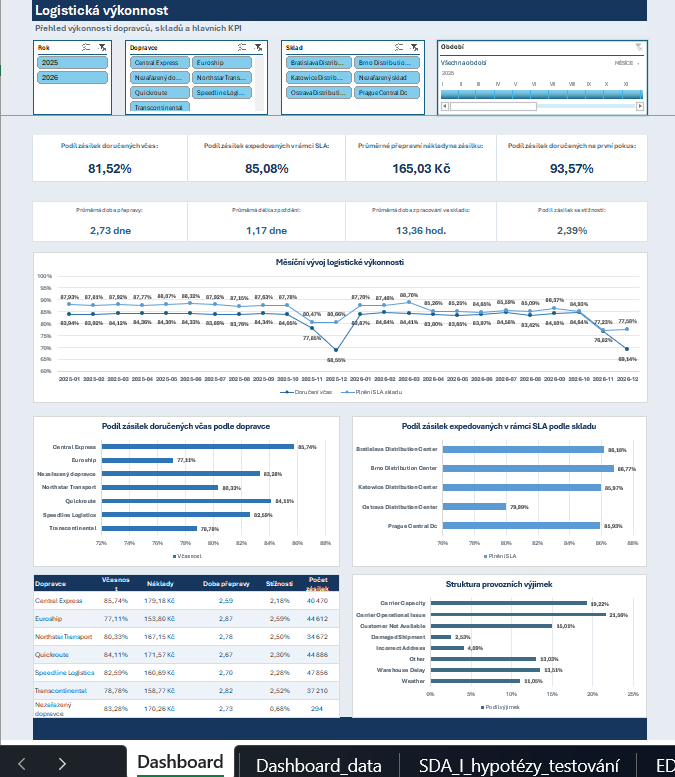

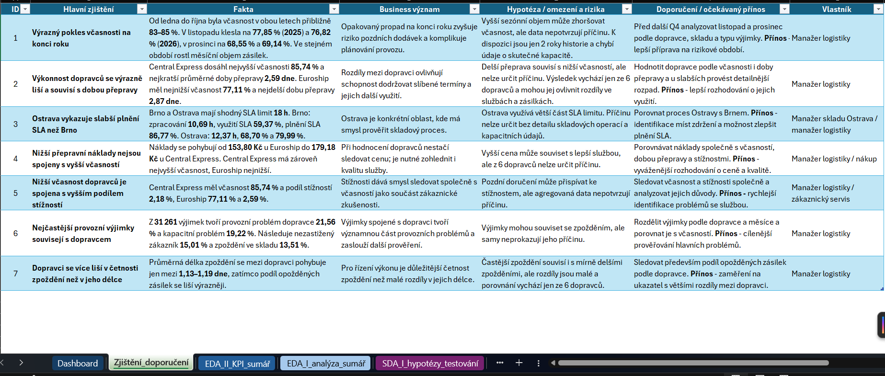

➡️ [Otevřít Project 01](projects/project-01-csv-excel-power-query/)

---

## ✅ Project 02 — Customer Retention & Churn Analysis

**SQL Server + Power BI + DAX**

Dokončený end-to-end projekt zaměřený na zákaznickou retenci, churn, reaktivace a tržby ve smyšlené společnosti s předplatitelským modelem.

Projekt analyzuje **40 000 zákazníků, 44 277 předplatných a období 09/2024–08/2026**. Cílem je zjistit, které zákaznické skupiny odcházejí častěji, kdy je riziko odchodu nejvyšší, jaké důvody zákazníci uvádějí a jak se vyvíjejí návraty zákazníků a tržby.

Hlavní oblasti:

- načtení 6 CSV zdrojů do SQL Serveru;
- datové vrstvy `raw → staging → clean → analytics`;
- kontrola kvality, čištění, validace a reconciliation;
- měsíční analytická fact tabulka na úrovni zákazník × měsíc;
- churn, reaktivace, délka předplatného a tržby;
- hvězdicový model v Power BI;
- KPI a DAX measures;
- SQL EDA a interaktivní ověření v Power BI;
- dvoustránkový Power BI dashboard;
- interpretace zjištění a návrh business doporučení.

Hlavní technologie:

```text
SQL Server / LocalDB
SQL
Power BI
DAX
Git
GitHub
```

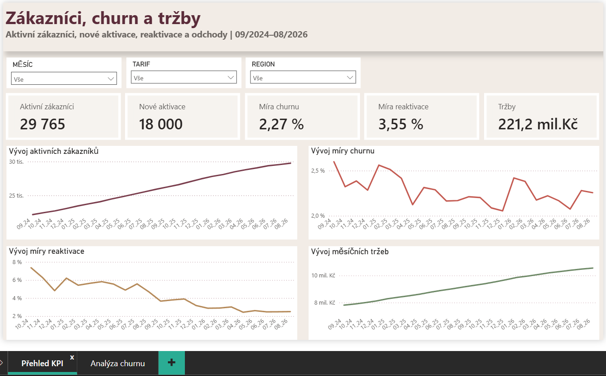

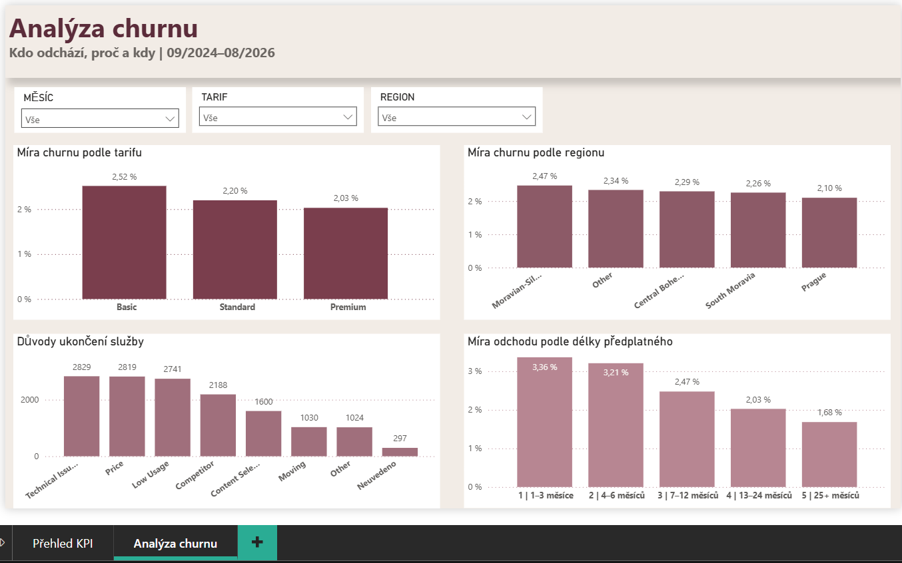

Analytická zjištění a business doporučení jsou shrnuta v projektu a ve větším detailu zde: [Zjištění a doporučení](projects/project-02-sql-power-bi-dax/output/findings_and_recommendations.md).

➡️ [Otevřít Project 02](projects/project-02-sql-power-bi-dax/)

---

## ✅ Project 03 — Investment Fund Performance & Risk Analytics

**API + Python + SQL Server + Power BI**

Dokončený end-to-end projekt zaměřený na historickou výkonnost a rizikové charakteristiky **6 vybraných investičních fondů ČSOB** – dvou akciových, dvou smíšených a dvou dluhopisových.

Projekt pracuje s reálnými veřejně dostupnými daty z ČSOB JSON endpointu. Cílem je ukázat, že samotný historický výnos neposkytuje úplný obraz o chování fondu a že je potřeba současně sledovat volatilitu, propady, dobu zotavení, stabilitu výkonnosti a vzájemné souvislosti mezi fondy.

Hlavní oblasti:

- získávání historických NAV dat z JSON endpointu;
- ukládání raw snapshotů a validace vstupních dat;
- inkrementální načítání do SQL Serveru;
- hvězdicový model a analytické SQL tabulky;
- výpočet kumulativního výnosu, CAGR, volatility, drawdownu a recovery time;
- rolling 12M analýza, korelace a společné poklesy;
- EDA a SDA v Pythonu;
- třístránkový Power BI dashboard;
- synchronizované slicery a dynamické společné období;
- automatizované denní spuštění přes `.bat` a Windows Task Scheduler;
- logging a kontrola jednotlivých běhů pipeline;
- interpretace zjištění a doporučení bez formulace investičních doporučení.

Hlavní technologický tok:

```text
ČSOB JSON endpoint
→ Python
→ raw data + validace
→ SQL Server / LocalDB
→ analytické výpočty
→ Power BI
```

Hlavní technologie:

```text
Python
Pandas
SciPy
API / JSON
SQL Server / LocalDB
SQL
Power BI
Power Query
DAX
BAT
Windows Task Scheduler
Git
GitHub
```

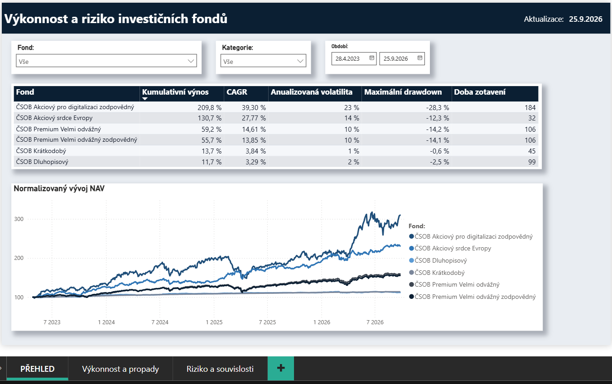

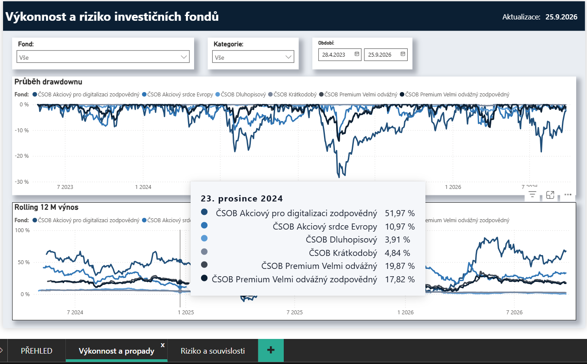

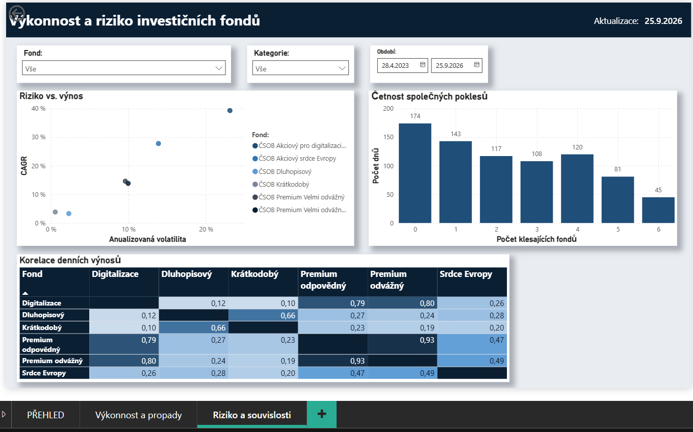

Analytická zjištění a doporučení jsou shrnuta v projektu a ve větším detailu zde: [Zjištění a doporučení](projects/project-03-api-python-sql-power-bi/output/findings_and_recommendations.md).

➡️ [Otevřít Project 03](projects/project-03-api-python-sql-power-bi/)

---

## ✅ Project 04 — Manufacturing Cost & Performance Controlling

**SQL Server + Power Query + Excel + Power BI + DAX**

Dokončený end-to-end projekt zaměřený na **výrobní controlling, nákladové odchylky a provozní výkonnost** smyšlené firmy vyrábějící kovové součástky.

Projekt zahrnuje **6 výrobků, 2 výrobní střediska a 3 stroje za období duben–září 2026**, s detailním vyhodnocením září a výchozím stavem zásob na konci března. Cílem je porovnat náklady s plánem a normami pro skutečnou výrobu, určit hlavní odchylky a posoudit jednu dodatečnou zakázku.

Hlavní oblasti:

- načtení CSV, validace a čištění ve vrstvách `raw → staging → clean → analytics`;
- samostatná agregace materiálu a práce bez násobení nákladů při spojování;
- propojení výroby, skutečnosti, norem a rozpočtu v Power Query;
- materiálová cenová a spotřební odchylka, mzdová odchylka hodin a sazby;
- režie po uzávěrkových úpravách proti původnímu rozpočtu;
- produktivita, zmetkovitost, prostoje a vývoj zásob;
- Excelové přehledy, trendy, úplná kalkulace a dodatečná zakázka;
- datový model se sdílenými dimenzemi, DAX a třístránkový Power BI report;
- interpretace výsledků a doporučení pro výrobu, nákup a údržbu.

Hlavní technologie:

```text
SQL Server / T-SQL
Power Query
Excel
Power BI
DAX
VS Code
Git
GitHub
```

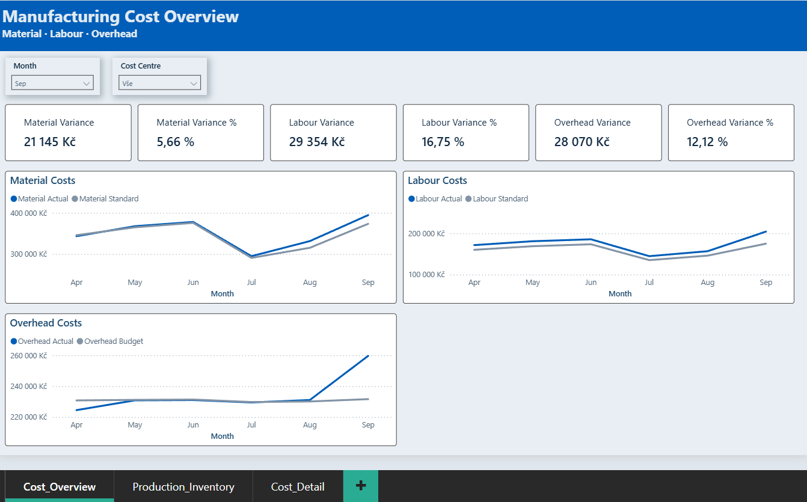

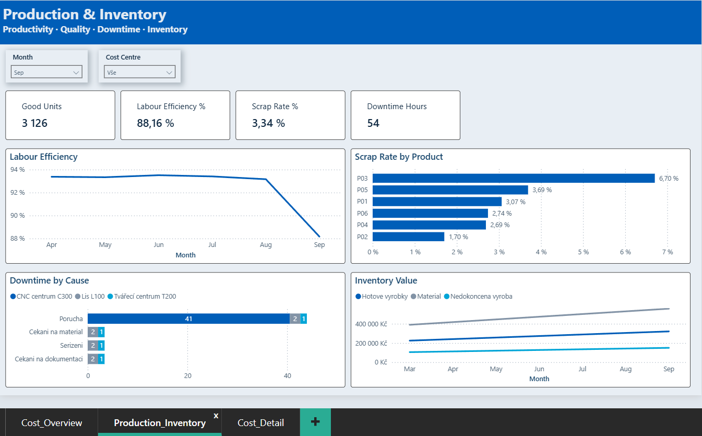

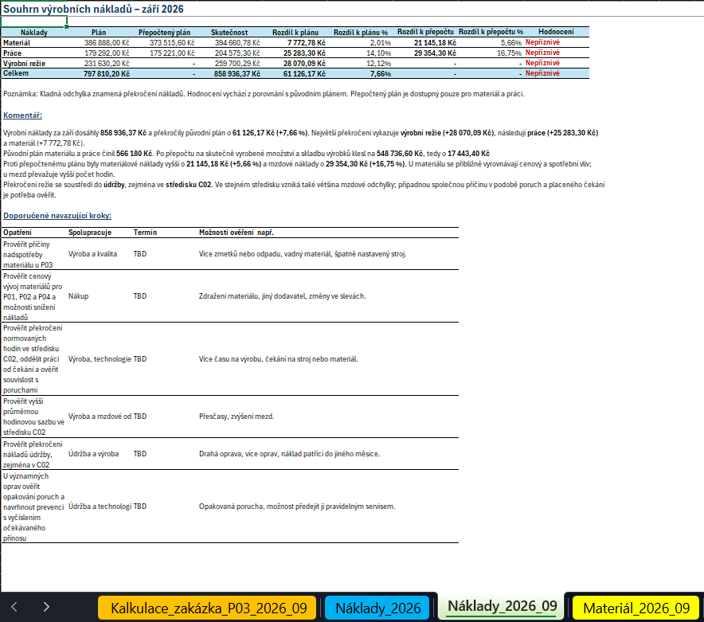

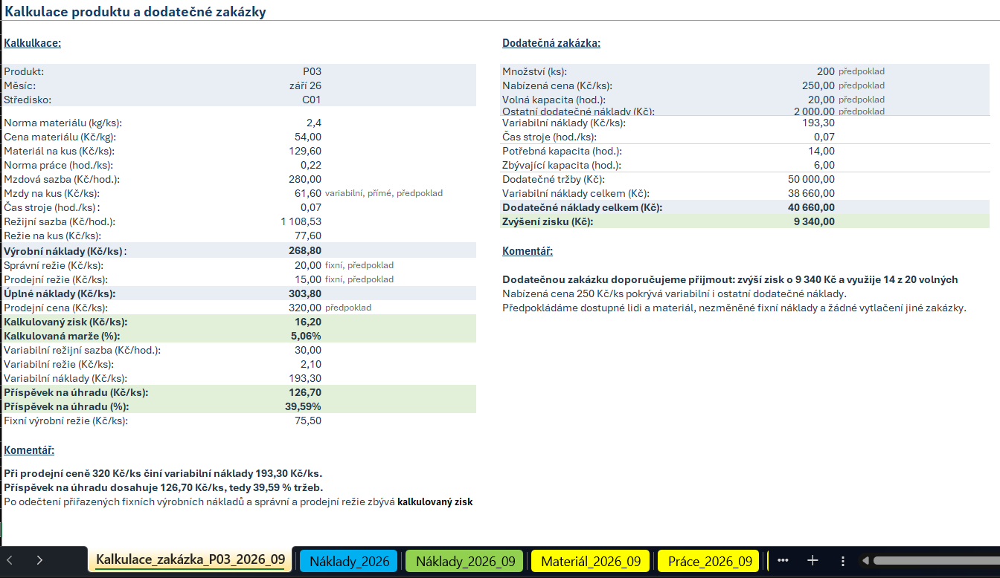

Závěry a doporučení: [Závěry a doporučení](projects/project-04-sql-excel-power-bi/output/findings_and_recommendations.md).

➡️ [Otevřít Project 04](projects/project-04-sql-excel-power-bi/)

---

## ✅ Project 05 — CNC Plant Performance, Cost Variances & Forecasting

**Excel + Power Query + Power Pivot + DAX**

Dokončený end-to-end projekt zaměřený na **výrobní výkonnost, nákladové odchylky a celoroční prognózu** smyšleného CNC závodu.

Projekt zahrnuje **18 výrobků, 4 střediska a 8 CNC strojů**. Skutečnost pokrývá leden–září 2026, plán celý rok; detailní hodnocení se soustředí na září. Výstupy jsou určené výrobnímu a finančnímu řediteli.

Hlavní oblasti:

- osm CSV zdrojů a příprava dat ve vrstvách `RAW → CLEAN → ANALYTICAL`;
- relační model v Power Pivotu, výpočtové sloupce a DAX míry;
- plnění výroby v kusech a normohodinách;
- rozklad objemu, mixu, změny WIP, spotřeby, cen, pracnosti a režie;
- OEE, využití kapacity a náklady nekvality (COPQ);
- zásoby materiálu, rozpracovanosti a hotových výrobků;
- úplné kalkulace a produktová ziskovost;
- celoroční nákladová prognóza a odchylky proti plánu;
- dva interaktivní Excel dashboardy s propojenými průřezy;
- interpretace výsledků, priority a doporučení pro vedení.

Hlavní technologie:

```text
Excel
Power Query
Power Pivot / Excel Data Model
DAX
Git / GitHub
```

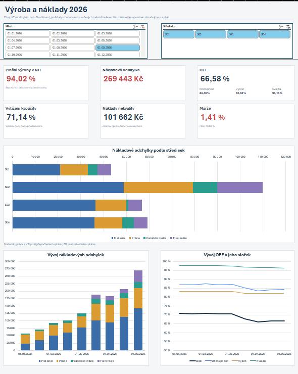

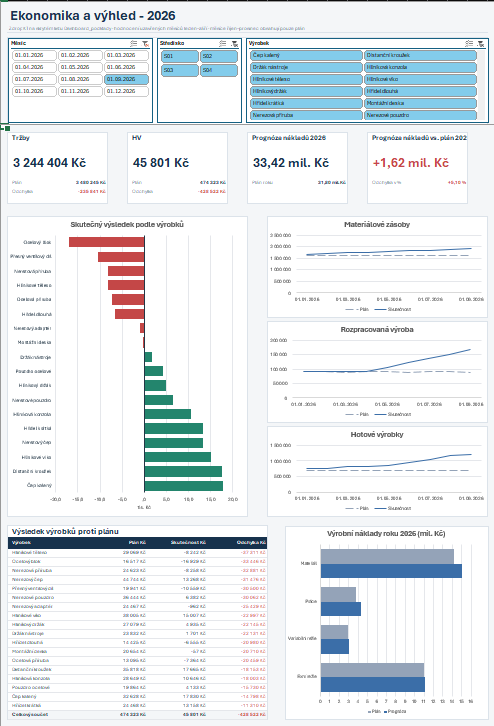

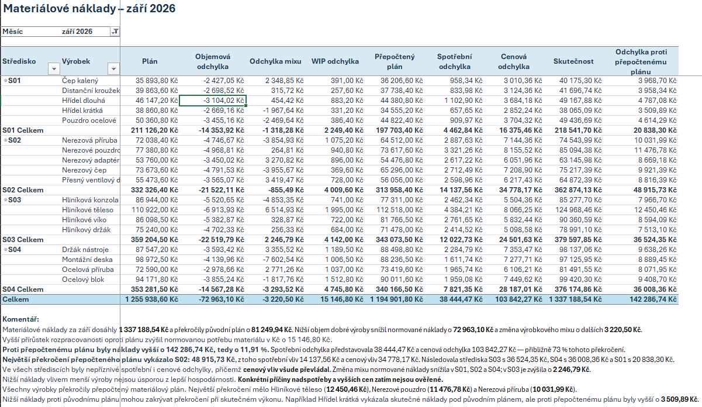

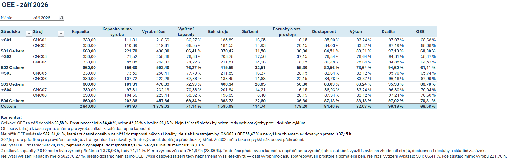

Zjištění a doporučení: [Podrobné závěry](projects/project-05-excel-power-pivot-dax/output/findings_recommendations.md).

➡️ [Otevřít Project 05](projects/project-05-excel-power-pivot-dax/)

---

# 🧭 Analytický workflow

Součástí repozitáře je také obecný analytický workflow používaný jako rámec pro plánování a realizaci jednotlivých projektů.

Pokrývá zejména:

```text
Business problém
→ datové zdroje
→ architektonické rozhodnutí
→ získání dat
→ kvalita a validace
→ transformace
→ analýza
→ datový model
→ KPI
→ dashboard
→ interpretace a doporučení
→ automatizace
→ dokumentace
```

Workflow slouží jako praktická kontrolní struktura, ne jako požadavek použít ve všech projektech stejné technologie nebo všechny možné kroky. Ve výrobním controllingu jej doplňuje porovnání plánu a skutečnosti, rozklad nákladových odchylek, provozní ukazatele, zásobové návaznosti, ziskovost a prognózy. Rozhodovací propočty jsou součástí projektu 04.

➡️ [Otevřít analytický workflow](workflow/analytical-workflow.md)

---

# 🧩 Zaměření portfolia

Jednotlivé projekty jsou záměrně postavené tak, aby ukazovaly odlišné analytické workflow:

```text
Project 01
→ Excel + Power Query
→ logistická výkonnost
→ hlavní transformace v Power Query

Project 02
→ SQL Server + Power BI
→ zákaznická retence
→ hlavní transformace a analytická příprava v SQL

Project 03
→ API + Python + SQL Server + Power BI
→ investiční fondy
→ získávání dat, automatizace a analýza časových řad

Project 04
→ SQL Server + Power Query + Excel + Power BI
→ výrobní controlling
→ nákladové odchylky, provozní KPI a ekonomické rozhodování
→ SQL příprava dat, Power Query transformace, Excel kalkulace a Power BI reporting

Project 05
→ Excel + Power Query + Power Pivot + DAX
→ výkonnost CNC závodu, nákladové odchylky a prognóza
→ objem a mix, OEE, COPQ, zásoby a produktová ziskovost
→ Power Query příprava dat, Power Pivot model a výpočty, dva Excel dashboardy
```

Cílem není použít všechny technologie v každém projektu, ale dát každému nástroji jasnou roli podle konkrétního business a datového problému.

---

# 🛠 Technologie a oblasti

```text
Excel
Power Query
Excel Data Model
Power Pivot
SQL / T-SQL
SQL Server LocalDB
Power BI
DAX
Python
Pandas
REST API
BAT
Windows Task Scheduler
data validation
data modeling
EDA
statistical analysis
KPI
dashboarding
automation
manufacturing controlling
production performance analysis
cost variance analysis
OEE
cost of poor quality (COPQ)
inventory analysis
product costing
product profitability
cost forecasting
decision analysis
Git
GitHub
VS Code
```