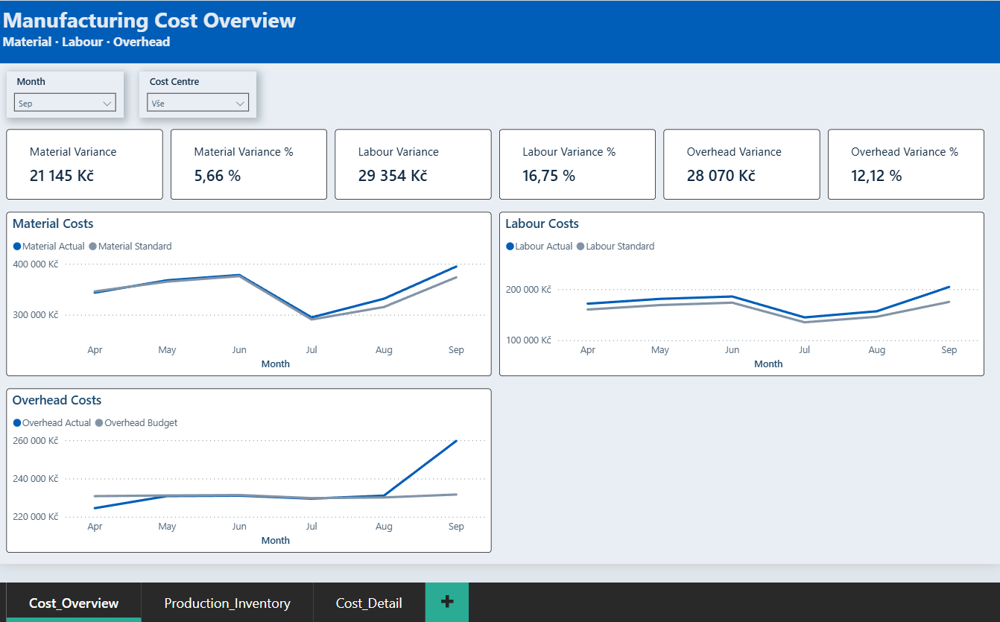
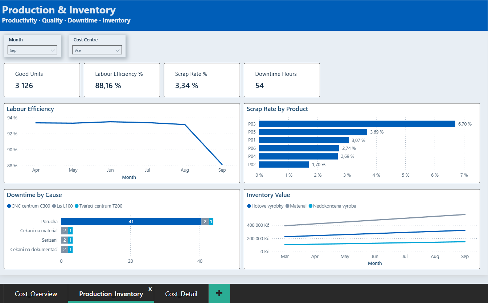
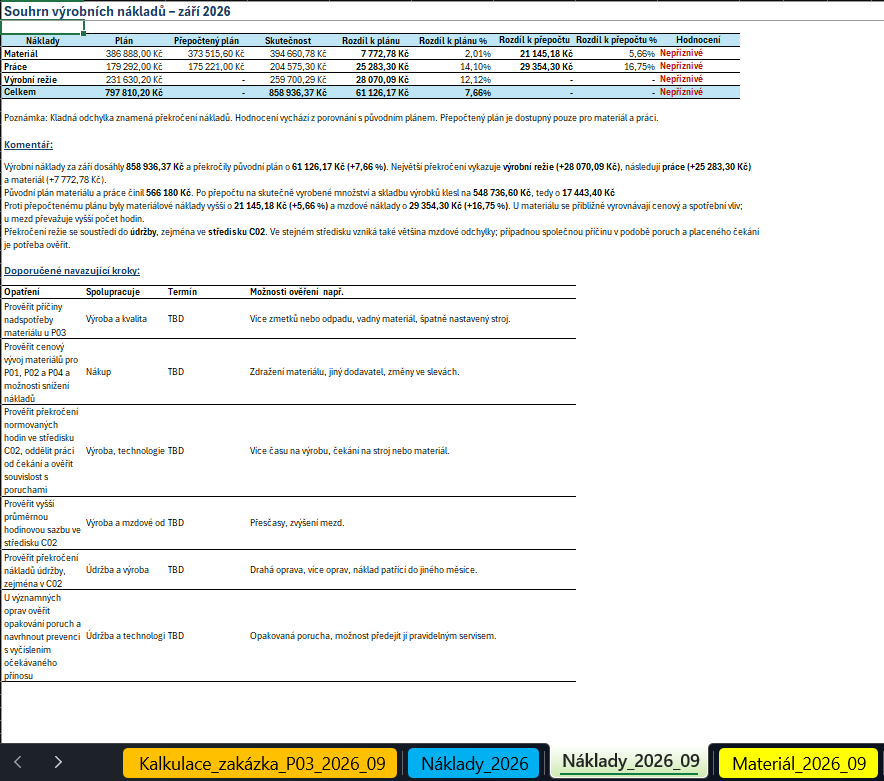
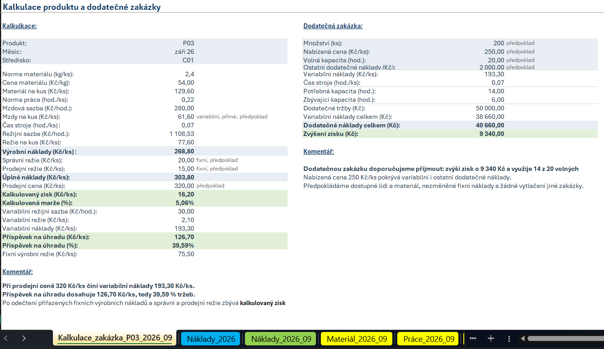
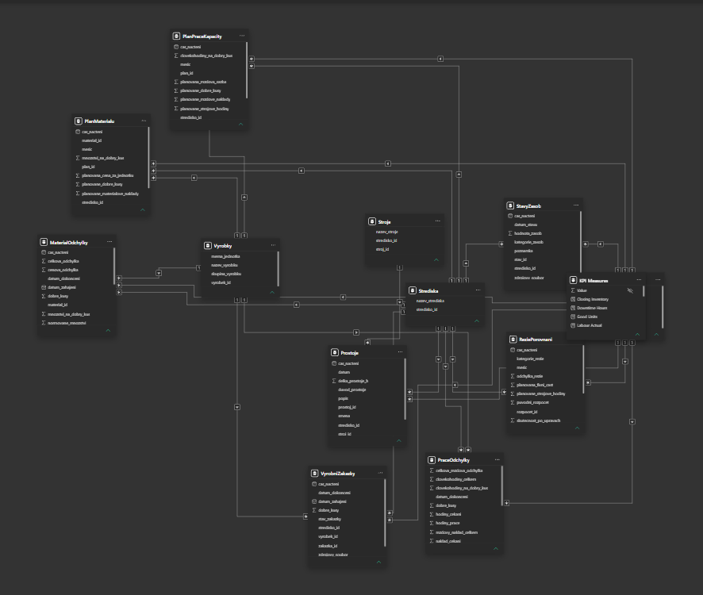
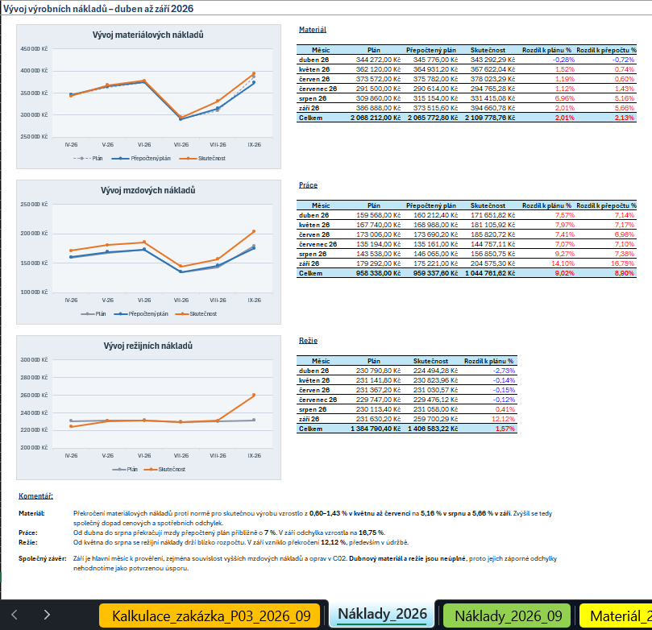
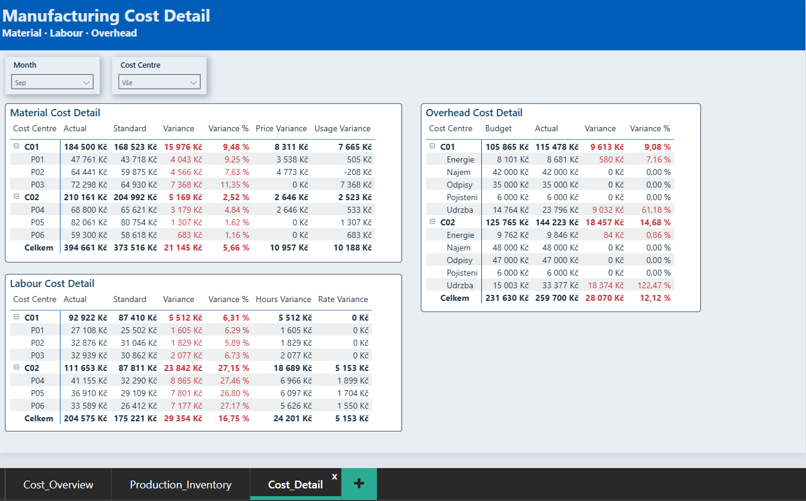

# Project 04 – Manufacturing Cost & Performance Controlling
## SQL Server, Power Query, Excel, Power BI & DAX

# Přehled projektu

Projekt analyzuje výrobní náklady a výkonnost smyšlené firmy vyrábějící kovové součástky. Cílem je porovnat náklady s plánem a normami pro skutečnou výrobu, určit hlavní odchylky, vyhodnotit provozní ukazatele a připravit podklady pro rozhodování.

Analýza zahrnuje **6 výrobků, 2 výrobní střediska a 3 stroje**. Nákladová a výrobní historie pokrývá **duben–září 2026**, detailní hodnocení se soustředí na **září 2026**. Vývoj zásob zahrnuje také výchozí stav na konci března.

- **Nástroje:** SQL Server, T-SQL ve VS Code, Power Query, Excel, Power BI a DAX.
- **Zpracování dat:** načtení CSV, validace, čištění, agregace skutečnosti, propojení s výrobou a normami.
- **Analýza:** nákladové odchylky, produktivita, zmetkovitost, prostoje, zásoby a ekonomika dodatečné zakázky v Excelu a Power BI.
- **Hlavní výstup:** třístránkový Power BI report, excelový sešit s nákladovou analýzou, kalkulací a rozhodovacím modelem.
- **Business přínos:** určení priorit pro výrobu, nákup a údržbu a oddělení úplné kalkulace od nákladů relevantních pro dodatečnou zakázku.









Podrobné závěry: [Závěry a doporučení](output/findings_and_recommendations.md).

---

# Business problém

V posledních měsících rostou výrobní náklady, objevují se prostoje a přibývají zásoby. Vedení potřebuje rozlišit, zda náklady odpovídají skutečnému množství a náročnosti výroby a kde vznikají odchylky.

Hlavní analytické otázky:

1. O kolik se materiálové a mzdové náklady liší od norem pro skutečnou dobrou výrobu?
2. Jakou část odchylky vysvětluje cena a spotřeba materiálu, případně hodiny a mzdová sazba?
3. Které výrobky a střediska nejvíce přispívají k překročení?
4. Jak se režie po uzávěrkových úpravách liší od původního rozpočtu?
5. Jak se vyvíjí produktivita, zmetkovitost a prostoje?
6. Ve kterých kategoriích rostou zásoby?
7. Jaká je kalkulace vybraného výrobku a vyplatí se přijmout dodatečnou zakázku?

Projekt hodnotí **výrobní náklady a hospodárnost závodu**, nikoliv úplnou účetní výsledovku firmy.

---

# Cíloví uživatelé

Primárními uživateli jsou **vedoucí závodu a finanční vedení**.

Na vysvětlení výsledků a návrhu opatření spolupracují:

- výroba a technologie;
- nákup a kvalita;
- údržba;
- plánování a logistika;
- obchod;
- účetní a mzdové oddělení.

Controller připravuje ekonomickou analýzu a doporučení. Provozní opatření zajišťují vlastníci příslušných procesů.

---

# Zdroje dat

Projekt používá syntetická CSV data simulující exporty výrobního a účetního systému. Zdrojové soubory jsou umístěné v `data/source/`.

| Zdroj | Obsah | Granularita |
|---|---|---|
| Výrobní zakázky | výrobek, středisko, termíny, dobré a zmetkové kusy | jedna zakázka |
| Materiálové výdeje | materiál, množství a hodnota spotřeby | jeden výdej |
| Pracovní záznamy | člověkohodiny, mzdy, práce a čekání | jeden časový záznam |
| Výrobní režie | nákladová položka, středisko a kategorie | jedna položka |
| Materiálové normy | spotřeba a plánovaná cena materiálu | norma výrobku a materiálu pro období |
| Výrobní normy | pracnost, strojový čas a mzdová sazba | výrobní norma pro období |
| Plán výroby | plánované dobré kusy | měsíc × výrobek × středisko |
| Rozpočet režie | fixní část a variabilní sazba | měsíc × středisko × kategorie |
| Prostoje | stroj, zakázka, důvod a délka | jedna událost |
| Stavy zásob | hodnota materiálu, rozpracované výroby a hotových výrobků | datum stavu × středisko × kategorie |
| Uzávěrkové úpravy | období, částka a důvod úpravy režie | jedna úprava |
| Číselníky | výrobky, materiály, střediska a stroje | jedna položka číselníku |

Nákladové a provozní analýzy využívají **duben–září 2026**. Zásoby jsou sledovány od **konce března do září 2026**.

---

# Architektura

Zpracování začíná načtením CSV do SQL Serveru. SQL zajišťuje validaci, čištění a jednoduché souhrny. Power Query propojuje skutečnost s výrobními zakázkami, normami a rozpočtem a připravuje analytické výpočty.

| Vrstva | Úloha |
|---|---|
| `raw` | uchování načtených zdrojových dat |
| `staging` | čištění a oddělení záznamů k prověření |
| `clean` | vyčištěná data pro další zpracování |
| `analytics` | jednoduché souhrny materiálu, práce a režie |
| Power Query | spojení podkladů, normované hodnoty a odchylky |
| Excel | nákladové přehledy, trendy, kalkulace a dodatečná zakázka |
| Power BI | datový model, DAX a interaktivní report |

**Excel a Power BI načítají podklady ze SQL samostatně. Power BI není závislé na Excelovém sešitu.**

---

# Role nástrojů

| Nástroj | Role v projektu |
|---|---|
| SQL Server / T-SQL | databázové vrstvy, kontroly, čištění a agregace |
| VS Code | příprava a spouštění SQL skriptů |
| Power Query | načtení, propojení a příprava analytických tabulek |
| Excel | kontingenční tabulky, vzorce, souhrny, grafy a rozhodovací výpočty |
| Power BI Desktop | datový model a třístránkový report |
| DAX | součtové a poměrové míry podle aktuálních filtrů |
| Git / GitHub | verzování a publikace projektu |

---

# Kvalita dat

Validace zahrnovala chybějící hodnoty, duplicity, datové typy, neplatné hodnoty, klíče, referenční integritu a vybraná business pravidla.

| Zjištěný problém | Zpracování |
|---|---|
| Chybějící množství materiálového výdeje | uložení k prověření, vyloučení z vyčištěných výdejů |
| Přesná duplicita materiálového výdeje | ponechání jednoho záznamu pomocí `ROW_NUMBER()` |
| Dvě režijní položky se stejným ID a rozdílnou částkou | oddělení obou záznamů k prověření |
| Materiálový výdej bez odpovídající zakázky | oddělení k prověření |
| Mezery v textovém údaji pracovních záznamů | sjednocení pomocí `TRIM()` |

Raw data zůstávají zachována. Neznámé hodnoty nejsou nahrazovány odhadem a konfliktní řádky nejsou svévolně vybírány jako správné. Po čištění následují opakované kontroly.

**Dubnové materiálové a režijní náklady jsou kvůli záznamům k prověření neúplné. Jejich záporné odchylky proto nejsou označené za potvrzenou úsporu.**

---

# Transformační proces

SQL analytická vrstva připravuje tři souhrny:

| Pohled | Granularita | Obsah |
|---|---|---|
| `analytics.v_MaterialSkutecnost` | zakázka × materiál | skutečné množství a náklad |
| `analytics.v_PraceSkutecnost` | zakázka | hodiny a mzdy, rozlišení práce a čekání |
| `analytics.v_RezieSkutecnost` | měsíc × středisko × kategorie | režijní skutečnost před uzávěrkovými úpravami |

Navazující kroky v Power Query:

- propojení materiálu a práce s výrobními zakázkami;
- přiřazení odpovídajících norem;
- výpočet normovaných množství, hodin a nákladů pro skutečné dobré kusy;
- rozklad materiálové a mzdové odchylky;
- propojení rozpočtu režie, skutečnosti a uzávěrkových úprav;
- příprava plánovaných materiálových a mzdových nákladů a strojových hodin;
- nastavení datových typů a ponechání pomocných dotazů bez načtení do modelu.

Materiál a práce se agregují **samostatně před spojením**, aby více výdejů a časových záznamů jedné zakázky nenásobilo náklady.

---

# Analytický model

Power BI používá více faktových tabulek propojených společnými číselníky.

| Tabulka | Obsah |
|---|---|
| `MaterialOdchylky` | materiálová skutečnost, normy a odchylky |
| `PraceOdchylky` | pracovní hodiny, mzdy, normy a odchylky |
| `ReziePorovnani` | rozpočet, skutečnost a uzávěrkové úpravy |
| `PlanMaterialu` | plánované materiálové náklady |
| `PlanPraceKapacity` | plánované mzdy a strojové hodiny |
| `VyrobniZakazky` | dobré a zmetkové kusy |
| `Prostoje` | prostojové události |
| `StavyZasob` | měsíční hodnoty kategorií zásob |

Dimenze tvoří **`Calendar`, `Vyrobky`, `Strediska` a `Stroje`**. Vztahy vedou jednosměrně z dimenzí do příslušných faktových tabulek. Míry jsou soustředěné v samostatné tabulce **`KPI Measures`**.



---

# KPI

Hodnoty níže odpovídají **září 2026 a všem střediskům**.

| KPI v Power BI | Hodnota | Význam / výpočet |
|---|---:|---|
| Material Variance | +21 145,18 Kč | skutečný materiálový náklad − norma pro skutečnou výrobu |
| Material Variance % | +5,66 % | materiálová odchylka / normovaný náklad |
| Labour Variance | +29 354,30 Kč | skutečné mzdy − normované mzdy |
| Labour Variance % | +16,75 % | mzdová odchylka / normované mzdy |
| Overhead Variance | +28 070,09 Kč | režie po úpravách − původní rozpočet |
| Overhead Variance % | +12,12 % | režijní odchylka / původní rozpočet |
| Good Units | 3 126 ks | počet dobrých kusů |
| Labour Efficiency % | 88,16 % | normohodiny dobré výroby / skutečné člověkohodiny včetně čekání |
| Scrap Rate % | 3,34 % | zmetkové kusy / všechny vyrobené kusy |
| Downtime Hours | přibližně 54 hodin | součet délky prostojů |
| Closing Inventory | 1 029 000 Kč | hodnota zásob k poslednímu dostupnému datu ve výběru |

Kladná nákladová odchylka znamená překročení. Procentní ukazatele se počítají ze součtů vstupních hodnot, nikoliv průměrem dílčích procent. Stavy zásob se nesčítají přes měsíce.

---

# Analýza

Analýza probíhala v Excelu a Power BI nad podklady připravenými v SQL a Power Query.

Excel obsahuje:

- zářijové přehledy materiálu, práce a režie;
- porovnání původního plánu, přepočteného plánu a skutečnosti;
- absolutní a relativní odchylky, komentáře a navazující kroky;
- měsíční tabulky a grafy vývoje nákladů;
- výrobní a úplnou kalkulaci P03;
- posouzení jedné dodatečné zakázky podle relevantních nákladů a kapacity.

V Excelu jsou využité kontingenční tabulky i funkce **`SUMIFS`, `XLOOKUP` a `IFS`**.



---

# Dashboard

Power BI report používá **režim Import**, anglické názvy ukazatelů a vlastní modro-šedý motiv. Obsahuje tři stránky.

## 1. Cost Overview

- šest KPI karet: materiálová, mzdová a režijní odchylka v Kč a procentech;
- vývoj skutečných a normovaných materiálových nákladů;
- vývoj skutečných a normovaných mzdových nákladů;
- vývoj skutečné režie po úpravách a původního rozpočtu.

## 2. Production & Inventory

- čtyři KPI karty: dobré kusy, Labour Efficiency, zmetkovitost a prostoje;
- vývoj Labour Efficiency;
- zmetkovitost podle výrobku;
- prostoje podle příčiny a stroje;
- vývoj hodnoty materiálu, nedokončené výroby a hotových výrobků.

## 3. Cost Detail

- materiálová matice podle střediska a výrobku, včetně cenové a spotřební odchylky;
- mzdová matice podle střediska a výrobku, včetně odchylky hodin a sazby;
- režijní matice podle střediska a kategorie.



Na stránkách jsou filtry **Month** a **Cost Centre**. Výběr měsíce ovlivňuje karty a detailní přehledy; měsíční trendové grafy zachovávají historii. Filtr střediska umožňuje porovnání jednotlivých provozů.

---

# Zjištění

Hlavní výsledky za září 2026:

1. **Výrobní náklady překročily původní plán o 61 126,17 Kč (+7,66 %).** Skutečnost dosáhla 858 936,37 Kč.
2. **Materiál překročil normu o 21 145,18 Kč (+5,66 %).** Cenový a spotřební vliv jsou přibližně vyrovnané. Největší spotřební odchylku má P03.
3. **Práce překročila normu o 29 354,30 Kč (+16,75 %).** C02 představuje 81,2 % celkové mzdové odchylky; převažuje vliv hodin.
4. **Údržba vysvětluje přibližně 97,6 % režijního překročení.** Největší překročení údržby má C02.
5. **Labour Efficiency klesla na 88,16 %.** V dubnu–srpnu se pohybovala přibližně mezi 93–94 %.
6. **P03 má nejvyšší zmetkovitost: 6,70 %.** Mezi prostoji dominují poruchy, zejména CNC centra C300.
7. **Zásoby vzrostly proti srpnu o 51 500 Kč (+5,27 %) na 1 029 000 Kč.** Rostou všechny tři kategorie.
8. **Modelová dodatečná zakázka zlepšuje výsledek o 9 340 Kč.** Vyžaduje 14 z 20 předpokládaných volných strojových hodin.

Podrobnosti: [Závěry a doporučení](output/findings_and_recommendations.md).

---

# Doporučení

| Oblast | Doporučení | Spolupráce |
|---|---|---|
| Materiál P03 | Prověřit nadspotřebu a nejčastější vady. | Výroba, kvalita, technologie |
| Ceny materiálů | Prověřit cenový vývoj pro P01, P02 a P04. | Nákup |
| Práce C02 | Oddělit práci od čekání a vysvětlit vyšší průměrnou sazbu. | Výroba, technologie, mzdové oddělení |
| Údržba a prostoje | Prověřit významné a opakované poruchy, zejména C300. | Údržba, výroba |
| Zásoby | Ověřit využití materiálu, dokončení rozpracované výroby a odbyt hotových výrobků. | Plánování, výroba, logistika, obchod |
| Úplnost dat | Dořešit dubnové záznamy k prověření. | Vlastníci dat, účetní oddělení |
| Dodatečná zakázka | Přijmout po potvrzení kapacitních a nákladových předpokladů. | Obchod, plánování, výroba |

Konkrétní odpovědné osoby a termíny se doplní po dohodě. Přesné úspory provozních opatření nejsou bez potvrzených podkladů vyčíslené.

---

# Automatizace

Projekt používá ručně spouštěné SQL skripty a uložené transformační kroky Power Query. Nemá externí plánovač ani automatickou aktualizaci v Power BI Service.

Výstupy představují uzavřenou analýzu dostupného období. **Pro jejich prohlížení není nutná obnova dat ani přidávání dalších měsíců.**

---

# Omezení

- Dataset je syntetický a provozní příčiny nejsou prokázány samotnými odchylkami.
- Dubnové materiálové a režijní náklady jsou neúplné; toto omezení ovlivňuje i souhrny celého období.
- Materiál a práce se porovnávají s normou pro skutečnou dobrou výrobu; samostatný rozklad objemu a mixu není součástí projektu.
- Režie se porovnává s původním rozpočtem bez flexibilního přepočtu.
- Zásoby jsou dostupné jako hodnotové měsíční stavy; neumožňují analýzu šarží, stáří ani přesného důvodu růstu.
- Výrobní náklady nejsou automaticky náklady prodaných výrobků; projekt nepočítá celkový provozní zisk firmy.
- Kalkulace a dodatečná zakázka používají označené předpoklady, včetně variabilních přímých mezd, cen a volné kapacity.
- Rozsah neobsahuje OEE, celoroční prognózu ani test přidání říjnových dat.
- Peněžní vizuály Power BI jsou zaokrouhlené na celé Kč; Excel uvádí haléře.

---

# Jak projekt spustit

## Prohlížení hotových výstupů

1. Stáhnout a otevřít `excel/manufacturing_controlling.xlsx` v Microsoft Excelu.
2. Stáhnout a otevřít `power-bi/production_controlling.pbix` v Power BI Desktopu.
3. Prohlížet uložené výsledky bez obnovy dat.

Pro prohlížení uložených výsledků není potřeba vytvářet SQL databázi. Bez Excelu a Power BI Desktopu lze použít screenshoty a [závěry a doporučení](output/findings_and_recommendations.md).

## Opakování přípravy a obnova dat

Vyžaduje SQL Server, nástroj pro spuštění T-SQL, Microsoft Excel s Power Query a Power BI Desktop.

1. Zachovat strukturu projektu a zajistit dostupnost CSV v `data/source/`.
2. V prvním SQL skriptu upravit absolutní cesty importu podle svého umístění souborů.
3. Spustit SQL skripty ve složce `sql/` v pořadí **01 → 02 → 03**.
4. Zkontrolovat výstupy validace a záznamy k prověření.
5. V Excelu a Power BI upravit SQL připojení na vlastní instanci a databázi `manufacturing_controlling`.
6. V Excelu použít **Data → Aktualizovat vše** a zkontrolovat navazující kontingenční tabulky.
7. V Power BI použít **Obnovit / Refresh**.

SQL skripty vytvářejí a nahrazují projektové objekty; spouštějí se v databázi určené pro tento projekt. Excel a Power BI se obnovují samostatně.

---

# Struktura repozitáře

```text
project-04-sql-excel-power-bi/
├── data/
│   └── source/
├── excel/
│   └── manufacturing_controlling.xlsx
├── output/
│   ├── screenshots/
│   │   ├── 01_cost_overview.png
│   │   ├── 02_production_inventory.png
│   │   ├── 03_cost_detail.png
│   │   ├── 04_excel_cost_summary.png
│   │   ├── 05_excel_costing_special_order.png
│   │   ├── 06_power-bi_data_model.png
│   │   └── 07_excel_cost_trends.png
│   └── findings_and_recommendations.md
├── power-bi/
│   ├── power_bi_theme.json
│   └── production_controlling.pbix
├── production-controlling-cheatsheet/
│   └── cheatsheet.md
├── sql/
│   ├── 01_create_database_schemas_raw_layer.sql
│   ├── 02_validate_clean_revalidate.sql
│   └── 03_analytics_views.sql
├── .gitignore
└── README.md
```

- `data/source/` – zdrojová syntetická CSV data.
- `excel/` – nákladová analýza, kalkulace a dodatečná zakázka.
- `output/` – závěry, doporučení a screenshoty.
- `power-bi/` – report a použitý barevný motiv.
- `production-controlling-cheatsheet/` – doplňující přehled principů výrobního controllingu.
- `sql/` – vytvoření databáze a import (01), validace a čištění (02), analytické pohledy (03).

---

# Co projekt ukazuje v portfoliu

Projekt propojuje **datovou přípravu, výrobní ekonomiku a manažerský reporting**. Doplňuje předchozí projekty o práci s normami, nákladovými odchylkami, uzávěrkovými úpravami a relevantními náklady pro rozhodování.

Hlavní dovednosti:

- SQL validace, čištění, agregace a analytické pohledy;
- Power Query a spojování tabulek s různou úrovní detailu;
- Excelové vzorce, kontingenční tabulky, grafy a kalkulace;
- datový model, DAX a interaktivní Power BI report;
- interpretace nákladových a provozních ukazatelů;
- oddělení doložených výsledků od příčin vyžadujících prověření;
- dokumentace a publikace prostřednictvím GitHubu.