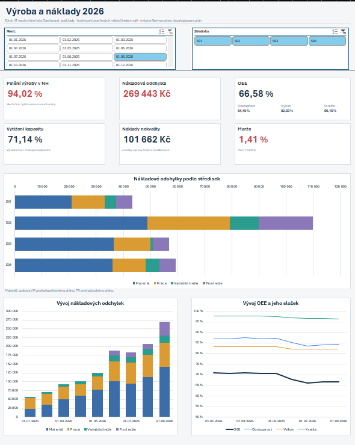
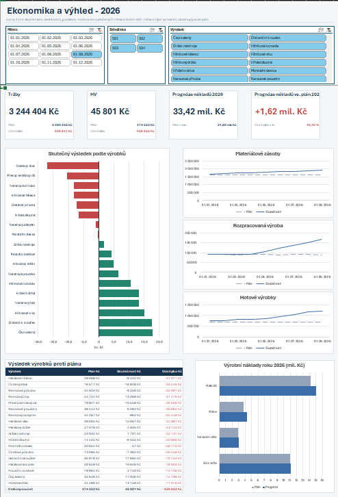
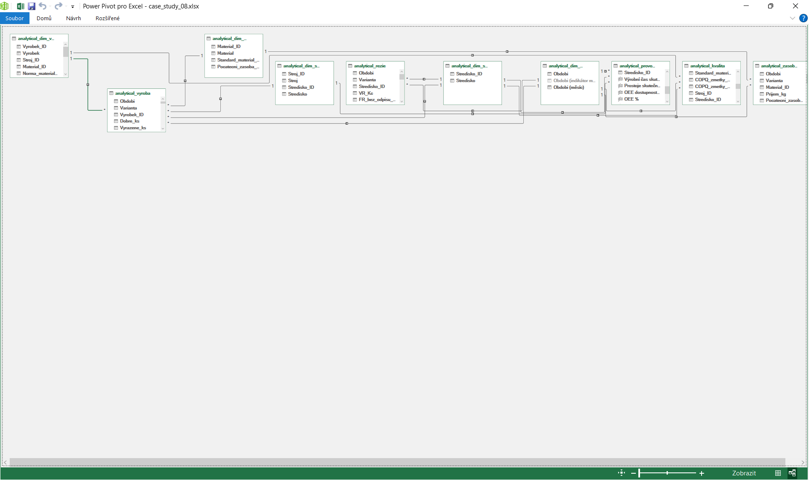
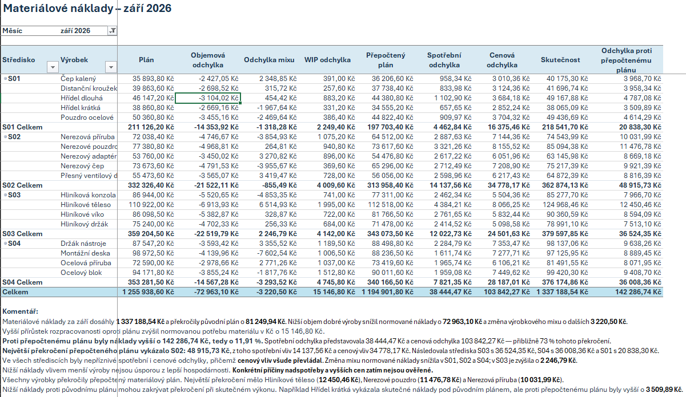
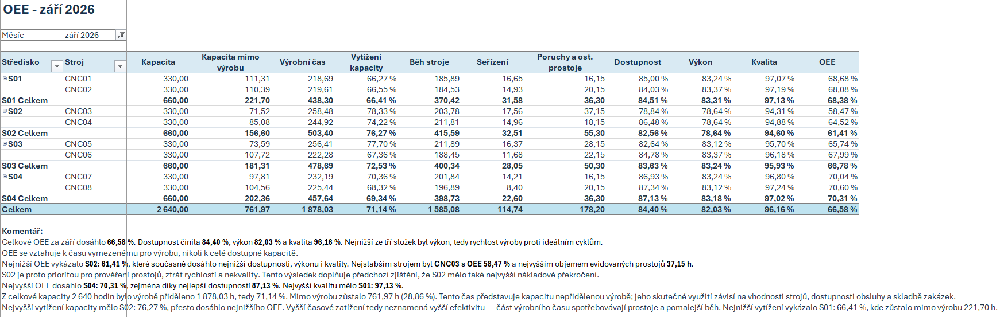

# Project 05 – CNC Plant Performance, Cost Variances & Forecasting
## Excel, Power Query, Power Pivot & DAX

# Přehled projektu

Projekt analyzuje plnění výroby, nákladové odchylky, provozní efektivitu, kvalitu, zásoby a ziskovost výrobků smyšleného podniku vyrábějícího kovové součástky na CNC strojích. Cílem je vysvětlit rozdíly proti plánu, určit priority pro prověření provozních příčin a aktualizovat celoroční nákladovou prognózu.

Analýza zahrnuje **18 výrobků, 4 výrobní střediska, 8 CNC strojů a 4 hlavní materiály**. Plán pokrývá **leden–prosinec 2026**, skutečnost **leden–září 2026**. Detailní hodnocení se soustředí na **září 2026**, trendy na devět uzavřených měsíců.

- **Nástroje:** Microsoft Excel, Power Query, Power Pivot, DAX a Git/GitHub.
- **Zpracování dat:** načtení osmi CSV, čištění a příprava vrstev RAW → CLEAN → ANALYTICAL, relační model a výpočty v Power Pivotu.
- **Analýza:** plnění výroby, rozklady nákladových odchylek, OEE, kapacita, náklady nekvality, zásoby, úplné kalkulace, produktová ziskovost a prognóza.
- **Hlavní výstup:** excelový sešit se dvěma interaktivními dashboardy a detailními tematickými reporty.
- **Business přínos:** propojení výrobních a finančních ukazatelů, určení problémových středisek a výrobků a návrh konkrétních kroků pro vedení.





Podrobné závěry: [Zjištění a doporučení](output/findings_recommendations.md).

---

# Business problém

Podnik nedosahuje plánovaného výrobního výkonu, přesto rostou nákladové odchylky a zásoby. Vedení potřebuje odlišit vliv objemu a skladby výroby od vyšší spotřeby, cen, pracnosti, prostojů a nekvality a posoudit dopad na ziskovost a roční výhled.

Hlavní analytické otázky:

1. Jak podnik plní výrobní plán v kusech a normohodinách?
2. Jakou část nákladových rozdílů vysvětluje objem, výrobkový mix a změna rozpracovanosti?
3. Kde vznikají cenové, spotřební, pracovní a režijní odchylky?
4. Která střediska a stroje mají nejnižší OEE a jaké jsou jeho složky?
5. Kolik stojí zmetky, opravy, třídění a reklamace?
6. Kde se hromadí materiál, rozpracovaná výroba a hotové výrobky?
7. Které výrobky dosahují ztráty nebo nejvíce zaostávají za plánovaným výsledkem?
8. Jaké výrobní náklady lze očekávat za celý rok při pokračování dosavadních nákladových poměrů?

Projekt hodnotí **výrobní výkonnost a související ekonomiku závodu**. Nezahrnuje úplnou účetní výsledovku ani samostatné investiční či obchodní rozhodovací scénáře.

---

# Cíloví uživatelé

Primárními uživateli jsou **výrobní ředitel a finanční ředitel**.

Na vysvětlení výsledků a realizaci opatření spolupracují:

- vedoucí výrobních středisek a technologie;
- údržba a kvalita;
- plánování výroby a zásobování;
- obchod;
- finanční controlling.

Controller propojuje provozní a ekonomické výsledky. Konkrétní příčiny a nápravná opatření ověřují vlastníci příslušných procesů.

---

# Zdroje dat

Projekt používá syntetická CSV data simulující měsíční výrobní a provozní podklady. Zdrojové soubory jsou ve složce `data/raw/`.

| Soubor | Obsah | Granularita | Řádky |
|---|---|---|---:|
| `vyrobky.csv` | výrobky, přiřazení stroje a materiálu, normy, sazby a počáteční zásoby | jeden výrobek | 18 |
| `stroje.csv` | stroje a jejich přiřazení ke střediskům | jeden stroj | 8 |
| `materialy.csv` | materiály, standardní ceny a počáteční zásoby | jeden materiál | 4 |
| `vyroba.csv` | výroba, spotřeba, práce, běh strojů, seřízení, prodej a WIP | měsíc × varianta × výrobek | 378 |
| `provoz_stroju.csv` | kapacita, výrobní čas, poruchy a ostatní prostoje | měsíc × varianta × stroj | 168 |
| `rezie.csv` | variabilní režie, fixní režie a odpisy | měsíc × varianta × středisko | 84 |
| `kvalita.csv` | opravované kusy, zdroje spotřebované na zmetky, opravy, třídění a reklamace | měsíc × výrobek, pouze skutečnost | 162 |
| `zasoby_materialu.csv` | příjmy materiálu | měsíc × varianta × materiál | 84 |

Varianta rozlišuje **PLAN** a **SKUTECNOST**. Budoucí skutečnost za říjen–prosinec není ve zdrojích nahrazena nulami.

---

# Architektura

Celé zpracování probíhá v Excelu. Power Query připravuje data, Power Pivot zajišťuje relace a analytické výpočty a kontingenční tabulky poskytují podklady reportům a grafům.

| Vrstva | Úloha |
|---|---|
| RAW | načtení původních CSV bez business výpočtů |
| CLEAN | čištění textů, sjednocení hodnot a nastavení datových typů |
| ANALYTICAL | příprava tabulek a číselníků pro datový model |
| Power Pivot | vztahy, výpočtové sloupce a DAX míry |
| Detailní reporty | tematické kontingenční tabulky, komentáře a tabulka prognózy |
| Dashboard_podklady | samostatné kontingenční podklady pro dashboardy |
| Dashboardy | KPI karty, grafy a propojené průřezy |

**Business výpočty jsou soustředěné v Power Pivotu.** Power Query slouží k přípravě dat. Dashboardové karty používají funkci `ZÍSKATKONTDATA` (`GETPIVOTDATA`), aby přebíraly hodnoty příslušných měr z kontingenčních tabulek.

Vyčištěné a analytické vrstvy jsou uložené jako dotazy v sešitu; složka `data/clean/` obsahuje dokumentaci zpracování, nikoli samostatný export všech vyčištěných tabulek.

---

# Role nástrojů

| Nástroj | Role v projektu |
|---|---|
| Power Query | načtení CSV, čištění a vrstvy RAW, CLEAN a ANALYTICAL |
| Power Pivot | relační model a výpočtové sloupce |
| DAX | plán, skutečnost, rozklady odchylek, poměrové KPI a prognóza |
| Excel | kontingenční tabulky a grafy, KPI karty, průřezy, podmíněné formátování a komentáře |
| Git / GitHub | verzování, dokumentace a prezentace výsledků |

Projekt nevyužívá SQL, Python ani Power BI. Analytický model i interaktivní reporting jsou součástí excelového sešitu.

---

# Kvalita dat

Příprava zahrnuje čištění textových hodnot, sjednocení označení a nastavení odpovídajících datových typů. Původní zdroje zůstávají oddělené od transformačních kroků.

| Oblast | Způsob zpracování |
|---|---|
| Textové hodnoty | odstranění nadbytečných mezer a netisknutelných znaků, sjednocení vybraných označení |
| Datové typy | rozlišení data, počtů kusů, hodin, kg a peněžních částek |
| Období | měsíční datum představované prvním dnem měsíce |
| Plán a skutečnost | samostatné řádky variant; kvalita obsahuje pouze skutečnost |
| Filtrace modelu | společné dimenze období a středisek pro příslušné faktové tabulky |
| Výstupy dashboardů | porovnání výchozích KPI s detailními reporty a zkoušky vybraných filtrů |

Při ověřování filtrace byla doplněna vazba střediska na provoz strojů, aby se při výběru střediska správně filtroval také výrobní čas ve jmenovateli OEE a kapacitních ukazatelů.

Podrobnosti přípravy a kvality dat: [Data quality & transformation](data/clean/data_quality_transformation.md).

---

# Transformační proces

1. Načtení osmi zdrojových CSV do dotazů RAW.
2. Vytvoření navazujících dotazů CLEAN a provedení čisticích kroků.
3. Příprava analytických tabulek a dimenzí výrobků, materiálů, strojů, středisek a období.
4. Načtení analytických tabulek do datového modelu a vytvoření vztahů 1 : N.
5. Doplnění výpočtových sloupců pro normované hodnoty, odchylky, zásobové návaznosti a alokace nákladů.
6. Vytvoření DAX měr pro souhrny, plnění, OEE, marže a prognózu.
7. Sestavení detailních kontingenčních reportů a dashboardových podkladů.
8. Napojení KPI karet, grafů a průřezů a ověření jejich chování.

Výpočty znovu používají existující míry. Původní plán zůstává zachován a odlišuje se od přepočteného plánu i od prognózy.

---

# Analytický model

Power Pivot používá pět faktových tabulek propojených společnými dimenzemi.

| Tabulka | Obsah |
|---|---|
| `analytical_vyroba` | výroba, materiál, práce, běh strojů, prodej, zásobové návaznosti a produktová ekonomika |
| `analytical_rezie` | variabilní a fixní režie včetně odpisů |
| `analytical_provoz_stroju` | kapacita, výrobní čas a prostoje |
| `analytical_kvalita` | zmetky, opravy, třídění a reklamace |
| `analytical_zasoby_materialu` | příjmy a pohyby materiálových zásob |

Dimenze tvoří **`analytical_dim_vyrobky`, `analytical_dim_materialy`, `analytical_dim_stroje`, `analytical_dim_strediska` a `analytical_dim_obdobi`**. Faktové tabulky nejsou propojené přímo mezi sebou. Filtrace se přenáší přes odpovídající vztahy z dimenzí.

Umístění míry v konkrétní tabulce samo o sobě neurčuje její filtraci; rozhodující jsou použité vstupy, vztahy a kontext výběru.



---

# KPI

Hodnoty odpovídají **září 2026, všem střediskům a všem výrobkům**, pokud není uvedeno jinak.

| KPI | Hodnota | Význam / výpočet |
|---|---:|---|
| Plnění výroby v NH | 94,02 % | normohodiny skutečné dobré výroby / plánované normohodiny |
| Výrobní nákladová odchylka | +269 443,34 Kč | materiál, práce a VR proti přepočtenému plánu; FR proti původnímu rozpočtu |
| OEE | 66,58 % | dostupnost × výkon × časově vážená kvalita |
| Dostupnost | 84,40 % | běh strojů / výrobní čas |
| Výkon | 82,03 % | ideální čas všech prvních průchodů / běh strojů |
| Kvalita OEE | 96,16 % | ideální čas dobrých kusů napoprvé / ideální čas všech prvních průchodů |
| Vytížení kapacity | 71,14 % | výrobní čas / dostupná kapacita |
| COPQ | 101 661,92 Kč | zmetky + opravy + třídění + reklamace |
| Zmetkovitost | 2,39 % | vyřazené kusy / dobré a vyřazené kusy celkem |
| Tržby | 3 244 404,07 Kč | prodané kusy × realizovaná cena |
| Hospodářský výsledek | 45 801,31 Kč | výsledek po zahrnutí nákladů a změn zásob podle modelu |
| Marže | 1,41 % | hospodářský výsledek / tržby |
| Prognóza výrobních nákladů roku | 33 424 741,90 Kč | skutečnost leden–září + odhad říjen–prosinec |
| Prognóza proti ročnímu plánu | +1 621 775,75 Kč / +5,10 % | rozdíl prognózy proti původnímu ročnímu plánu |

Kladná nákladová odchylka znamená překročení. Procenta se počítají ze souhrnných vstupů, nikoli průměrem řádkových procent. Stavy zásob se nesčítají přes měsíce.

---

# Analýza

Detailní excelové listy propojují tabulky, nákladové rozklady a slovní komentáře.

| Oblast | Obsah |
|---|---|
| Výroba | plán a skutečnost v kusech a NH, plnění podle výrobků a středisek |
| Materiál | původní plán → objem → mix → změna WIP → přepočtený plán → spotřeba a cena → skutečnost |
| Práce | objem, mix, seřízení, čekání, zbývající pracnost a hodinová sazba |
| Variabilní režie | objem, mix, efektivita a nákladová odchylka při skutečném běhu |
| Fixní režie | rozpočtová odchylka a samostatně odchylka výkonu |
| OEE a kapacita | stroje a střediska, dostupnost, výkon, kvalita, seřízení a prostoje |
| COPQ | náklady zmetků, oprav, třídění a reklamací |
| Zásoby | materiál, rozpracovanost a hotové výrobky v množství i Kč |
| Kalkulace | úplné plánované náklady na kus, cena, zisk a marže |
| Produktová ziskovost | plánované a skutečné tržby, výsledek, odchylka a marže |
| Prognóza | plán a roční výhled materiálu, práce, VR a FR v Kč a procentech |

Rozklad objemu a mixu se provádí po střediscích; podnikový souhrn je součtem těchto efektů. Materiál navíc odděluje změnu rozpracovanosti, aby nebyla skryta ve spotřební odchylce.





---

# Dashboard

Sešit obsahuje **dva interaktivní dashboardové listy** s českými popisky, jednotným modro-šedým vzhledem a barevným rozlišením příznivých a nepříznivých výsledků. Výchozí pohled je září 2026 a všechna střediska a výrobky.

## 1. Výroba a náklady

List `Dashboard_přehled` obsahuje:

- šest KPI karet: plnění výroby v NH, nákladová odchylka, OEE, vytížení kapacity, COPQ a marže;
- doplňující dostupnost, výkon a kvalitu OEE a plánovanou marži;
- skládaný pruhový graf nákladových odchylek podle středisek;
- měsíční vývoj materiálových, pracovních a režijních odchylek;
- vývoj OEE a jeho tří složek;
- průřezy období a střediska.

## 2. Ekonomika a výhled

List `Dashboard_ekonomika_výhled` obsahuje:

- čtyři KPI karty: tržby, hospodářský výsledek, roční nákladová prognóza a její odchylka proti plánu;
- skutečný výsledek všech výrobků, se ziskem zeleně a ztrátou červeně;
- tři grafy plánovaných a skutečných zásob: materiál, rozpracovanost a hotové výrobky;
- tabulku plánovaného a skutečného výsledku výrobků s odchylkou;
- roční plán a prognózu výrobních nákladů podle kategorií;
- průřezy období, střediska a výrobku.

| Výstup | Období | Středisko | Výrobek |
|---|---|---|---|
| KPI a odchylky podle středisek na prvním dashboardu | ano | ano | ne |
| Trend odchylek a OEE | pevně leden–září | ano | ne |
| Tržby, výsledek a produktové přehledy na druhém dashboardu | ano | ano | ano |
| Vývoj zásob | pevně leden–září | ne | ne |
| Roční prognóza | celý rok | ano | ne |

Kopie průřezů období a střediska sdílejí výběr mezi oběma dashboardy. Produktový filtr ovlivňuje pouze příslušné ekonomické přehledy. Zásoby zůstávají celofiremní a roční prognóza není závislá na výběru měsíce.

---

# Zjištění

Hlavní výsledky za září 2026:

1. **Výroba splnila plán na 94,02 % v NH.** Chybělo 404 dobrých kusů a 96,16 NH; plán nesplnilo žádné středisko.
2. **Výrobní nákladová odchylka činí +269 443,34 Kč.** Materiál a práce představují přibližně 78,2 % celku.
3. **U materiálu převažuje cenová odchylka 103 842,27 Kč.** Spotřební odchylka činí 38 444,47 Kč.
4. **S02 představuje 40,81 % celkové nákladové odchylky.** Současně má nejnižší OEE 61,41 % a nejvyšší COPQ 33 517,34 Kč.
5. **OEE kleslo od ledna o 4,18 procentního bodu na 66,58 %.** Nejslabším strojem je CNC03 s OEE 58,47 %.
6. **Zásoby jsou k 30. září přibližně o 833,9 tis. Kč nad plánem.** Překročení se týká všech tří kategorií.
7. **Zisk činí 45 801,31 Kč a marže 1,41 %.** Výsledek zaostává za plánem o 428 522,13 Kč; osm výrobků je ztrátových.
8. **Roční prognóza překračuje plán o 1 621 775,75 Kč / 5,10 %.** Materiál a práce tvoří přibližně 86,6 % očekávaného překročení.

Podrobnosti: [Zjištění a doporučení](output/findings_recommendations.md).

---

# Doporučení

| Oblast | Doporučení | Spolupráce |
|---|---|---|
| S02 a CNC03 | Prověřit opakující se poruchy, prostoje, ztráty rychlosti a vady. | Výroba, údržba, kvalita |
| Materiál | Vysvětlit cenové rozdíly proti standardům a prověřit nadspotřebu. | Controlling, nákup, technologie |
| Práce | Rozebrat vyšší pracnost, čekání a seřízení, přednostně na S02. | Výroba, technologie |
| Kvalita | Zaměřit se na nekvalitu S02 a reklamace Hliníkového tělesa. | Kvalita, výroba |
| Zásoby | Sladit materiálové příjmy a uvolňování výroby s očekávanou spotřebou a prodejem. | Plánování, zásobování, obchod |
| Ziskovost | Prověřit Ocelový blok a Hliníkové těleso; oddělit vliv cen, výrobních odchylek, reklamací a zásob. | Controlling, výroba, obchod |
| Výhled | Měsíčně aktualizovat prognózu a sledovat doložené výsledky opatření. | Controlling |

Souběh problémů na S02 určuje prioritu šetření, ale neprokazuje jednu společnou příčinu. Přesné úspory opatření nejsou bez potvrzených podkladů vyčíslené.

---

# Automatizace

Projekt používá uložené transformační kroky Power Query, výpočty v Power Pivotu a navazující kontingenční tabulky. Obnova se spouští ručně v Excelu; externí plánovač není součástí řešení.

Průřezy přepočítávají výstupy nad již načteným datovým modelem bez opětovného načítání CSV.

Výstupy představují analýzu dostupného období. **Pro prohlížení uložených výsledků není nutná obnova dat ani přidávání dalších měsíců.** Přidání nového období vyžaduje také kontrolu časového rozsahu reportů, grafů a prognózy.

---

# Omezení

- Data jsou syntetická; analytické odchylky samy neprokazují konkrétní provozní příčiny.
- Každý výrobek má jeden hlavní materiál, pevně přiřazený stroj a středisko. Víceoperační postupy a přesuny se nemodelují.
- Technické normy a standardní ceny jsou pro rok konstantní. Norma materiálu zahrnuje běžný technologický odpad, nikoli mimořádné zmetky.
- WIP představuje materiálové polotovary před CNC: 100 % materiálu a 0 % práce a režie. Oceňuje se standardním materiálovým nákladem.
- Hotové výrobky se oceňují jednotnou lednovou plánovanou výrobní kalkulací včetně výrobní fixní režie po celý rok.
- Opravy probíhají ručně v témže měsíci bez dalšího CNC cyklu. Dobré kusy zahrnují i úspěšně opravené kusy; kvalita OEE vychází z dobrých kusů napoprvé a váží se ideálními časy.
- Interní COPQ je oceněno standardními sazbami a je již součástí výrobních nákladů. Reklamace jsou do výsledku zahrnuty samostatně a pouze jednou.
- Skutečná VR se výrobkům přiděluje podle běhu strojů; FR podle normohodin dobré výroby. Odchylka výkonu FR není další náklad.
- Správa a prodejní režie jsou zjednodušené měsíční předpoklady: plán 160 000 a 90 000 Kč, skutečnost 166 000 a 92 000 Kč. Rozvrh používá standardní variabilní náklady prodaných kusů bez seřízení a čekání.
- Výsledek zahrnuje tržby, výrobní náklady, změny hodnoty WIP a hotových výrobků, správu, prodej a reklamace. Nejde o úplný účetní výsledek po zdanění.
- Prognóza přenáší dosavadní nákladové poměry na plán říjen–prosinec. U materiálu, práce a VR používá skutečnost vůči přepočtenému plánu, u FR vůči původnímu plánu. Nezahrnuje přínosy nových opatření.
- Prognóza se počítá v aktuálním výběru středisek; celofiremní poměr se může lišit od poměrů jednotlivých středisek. Celkový výhled proto nemusí být součtem samostatně filtrovaných výhledů.
- Průřez období zahrnuje i říjen–prosinec, pro které existuje pouze plán. Skutečné výsledky se hodnotí za leden–září.
- Součástí nejsou scénáře mimořádné zakázky, předvýroby, vlastní výroby versus nákupu ani investiční návratnosti.

---

# Jak projekt spustit

## Prohlížení hotových výstupů

1. Stáhnout a otevřít `excel/cnc_plant_performance.xlsx` v Microsoft Excelu.
2. Začít na prvních dvou listech s dashboardy a podle potřeby přejít na detailní reporty.
3. Použít průřezy období, střediska a výrobku v rozsahu příslušných přehledů.
4. Prohlížet uložené výsledky bez obnovy dat.

Pro plnou práci s modelem je určen desktopový Microsoft Excel pro Windows s Power Query a Power Pivotem. Bez Excelu lze použít screenshoty a [zjištění a doporučení](output/findings_recommendations.md).

## Opakování přípravy a obnova dat

1. Zachovat strukturu projektu a dostupnost osmi CSV v `data/raw/`.
2. V Power Query upravit zdrojové cesty jednotlivých RAW dotazů podle umístění projektu na svém počítači.
3. V Excelu použít **Data → Aktualizovat vše** a vyčkat na dokončení aktualizace dotazů a modelu.
4. Ověřit aktualizaci navazujících kontingenčních tabulek, dashboardů a zachování připojení průřezů.
5. Při rozšíření dat zkontrolovat rozsahy měsíců, dostupnost skutečnosti a časové hranice prognózy.

---

# Struktura repozitáře

```text
project-05-excel-power-pivot-dax/
├── data/
│   ├── clean/
│   │   └── data_quality_transformation.md
│   └── raw/
│       ├── kvalita.csv
│       ├── materialy.csv
│       ├── provoz_stroju.csv
│       ├── rezie.csv
│       ├── stroje.csv
│       ├── vyroba.csv
│       ├── vyrobky.csv
│       └── zasoby_materialu.csv
├── excel/
│   └── cnc_plant_performance.xlsx
├── output/
│   ├── screenshots/
│   │   ├── 01_dashboard_production_costs.png
│   │   ├── 02_dashboard_financial_performance_outlook.png
│   │   ├── 03_material_cost_variance_breakdown.png
│   │   ├── 04_oee_by_machine.png
│   │   └── 05_data_model.png
│   └── findings_recommendations.md
└── readme.md
```

- `data/raw/` – původní syntetická CSV data.
- `data/clean/` – dokumentace kvality dat a transformačních kroků.
- `excel/` – sešit s dotazy Power Query, datovým modelem, DAX, detailními reporty a dashboardy.
- `output/` – screenshoty, zjištění a doporučení.

---

# Co projekt ukazuje v portfoliu

Projekt propojuje **přípravu dat, relační model, výrobní ekonomiku a interaktivní reporting v Excelu**. Oproti projektu 04 rozšiřuje analýzu o samostatný objem a mix, návaznost rozpracovanosti, OEE, náklady nekvality, produktovou ziskovost a celoroční nákladovou prognózu.

Hlavní dovednosti:

- Power Query a organizace vrstev RAW → CLEAN → ANALYTICAL;
- modelování více faktových tabulek se společnými dimenzemi v Power Pivotu;
- DAX výpočtové sloupce a míry včetně správného kontextu filtrů;
- rozklady materiálových, pracovních a režijních odchylek;
- OEE, kapacitní ukazatele a náklady nekvality;
- zásobové návaznosti, úplné kalkulace a produktová ziskovost;
- prognóza nákladů při zachování původního plánu;
- kontingenční tabulky a grafy, `ZÍSKATKONTDATA` a propojené průřezy;
- formulace priorit a doporučení s oddělením doložených výsledků od příčin k prověření;
- dokumentace a prezentace výsledků prostřednictvím GitHubu.